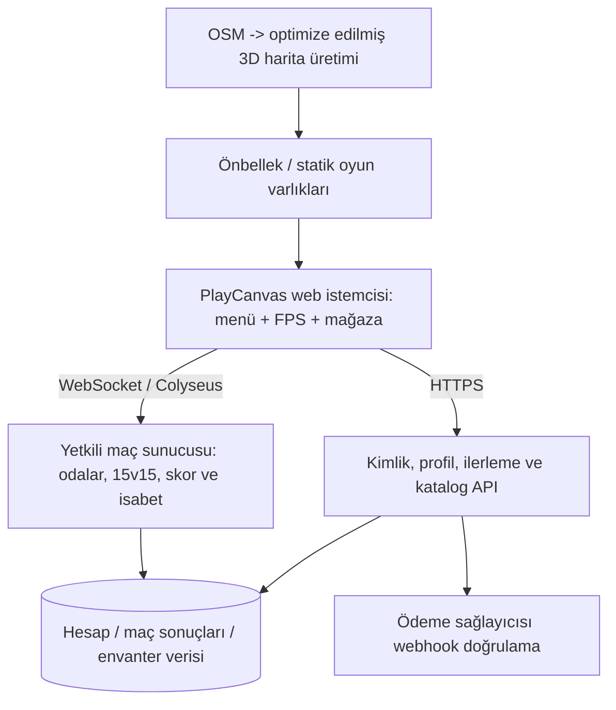

# Paintball Nations — Tam Oyun Ürün ve Mimari Planı (v1)

> ⚠️ **ARŞİV / V1:** Bu tasarım, yeni kalıcı dünya hedefinden önce hazırlanmış 15v15 oda odaklı ilk plandır. Güncel kararlar için [V2 tek dünya mimarisini](world-architecture-v2.md), [oyun sistemlerini](world-game-systems-v2.md) ve [uygulama planını](delivery-roadmap-v2.md) esas alın. Bu belgedeki oda-merkezli yapı artık ana ürünün bütünü değildir.

> **Durum:** Hedef ürün planı ve önerilen teknik kararlar. Bu belge, burada tanımlanan özelliklerin uygulanmış olduğu anlamına **gelmez**.
> **Temel karar:** Dağıtık, birbirinden kopuk gösterimler değil; tek oyun, tek kod tabanı, ortak veri modeli, bütünleşik test ve tek sürüm hattı.
> **İlk hedef platform:** Android Chrome / mobil tarayıcı. Oyuncu arayüzü PlayCanvas. Fiziksel bilgisayar veya sürekli pahalı bulut PC gerekli olmamalı.

## 1. Oyuncunun gördüğü eksiksiz ürün

**Paintball Nations**, farklı ülkelerin takımlarının 15'e 15 mücadele ettiği, birinci şahıs kameralı, renkli boya sporuna dayalı çevrim içi 3D oyundur.

**Tam kullanıcı yolculuğu:**
1. Oyun açılır, oyuncu misafir olarak antrenmana girebilir; kalıcı hesap isterse kayıt veya güvenli giriş seçer.
2. Ülkesini seçer, takım profilini görür, ücretsiz başlangıç boya atıcısını ve temel koruyucu spor kıyafetini alır.
3. Arkadaşlarını davet edebilir, bir maça katılabilir veya oda kurabilir. Eşleştirici oyunu en fazla 15 mavi + 15 kırmızı oyuncuyla doldurur.
4. Harita yüklenir; mobil sanal çubukla hareket, sağ tarafla bakış ve BOYA düğmesiyle atış yapılır.
5. Takım skorları, süre, isabet, boyayla işaretlenme, yeniden oyuna dönüş ve maç sonu sonuçları sunucu tarafından yönetilir.
6. Maç bitince sonuç, ülke sıralaması ve kazanılmış oyun içi ilerleme profilde görünür.
7. Mağazada özel **görünümler** ve ekipman kaplamaları gösterilir; para harcamayan oyuncu aynı oyun mekaniğini kullanabilir.
8. Bir sonraki maç ve farklı ülke arenası aynı oyuncu hesabı ve oyun arayüzünden açılır.

**Hedef kapsam:**
- Birinci şahıs mobil ve masaüstü web desteği; PlayCanvas 3D, yatay mobil kontrol.
- **15v15 = 30 gerçek eşzamanlı oyuncu** hedefi; doluluk farklıysa bekleme odası / açık durum göstergesi.
- Başlangıçta beş kurgusal spor arenası, gerçek OSM yerleşim verilerinden **esinlenerek** inşa edilecek: İstanbul/Maçka, Berlin/Tempelhof, Rio/olimpik alan, Tokyo/Yoyogi, Londra/Olimpik Park.
- Oyun modları: ilk sürümde takım skor maçı; turnuva/lig sonradan etkinleşebilir.
- Ücretsiz temel boya atıcısı, premium kozmetik ekipmanlar. **Pay-to-win yok:** hız, menzil, isabet veya oyun gücü ücretle artmaz.
- Hesap, profil, ülke seçimi, oda, arkadaş daveti, sıralama, takım sonuçları, içerik yönetimi, oyun ayarları.
- Güvenlik: yaşa uygun metin/isim filtreleri; raporlama, engelleme, sohbeti kısıtlama, veri minimizasyonu, uygun ödeme ve ebeveyn onayı gereklilikleri.
- OSM atfı: oyun içinde **© OpenStreetMap contributors**, bağlantı ve ODbL koşulları. OSM verisini mağaza görselleri veya üçüncü taraf harita döşemeleriyle karıştırmamak.

**İlk tasarım varsayımları (henüz oyun testiyle doğrulanmadı):**
- Takım karşılaşması 10 dakika; boya isabetinde puan, kısa yeniden doğma süresi, maç sonunda en yüksek takım skoru.
- Rekabetçi varsayılan mod: 15+15 gerçek oyuncu; eksik katılımcı için uygulama akışı ayrı gösterilir, botlar oyuncu sayısı gibi sunulmaz.
- 3D görsel kalite hedefi: mobil donanıma uygun, stilize edilmiş yüksek kaliteli spor arenası; kesin FPS hedefi gerçek Android testine bağlı.

## 2. Tek ürün için önerilen sistem mimarisi



| Modül | Tek sorumluluğu | Temel kontrat |
|---|---|---|
| CLIENT | Menü, kamera, dokunmatik kontrol, animasyon, sahne ve ses | Sunucuya **yalnızca oyuncu niyeti/girdi** gönderir; maç sonucunu belirleyemez |
| PROTOCOL | İstemci ve sunucu ortak olay/sürüm tipleri | `Join`, `Input`, `PlayerState`, `PaintHit`, `MatchResult`, `Entitlement` sürümlü olur |
| MATCH | 30 oyuncu kapasitesi, takımlar, spawn, skor, süre, maç sonu | Sunucu yetkilidir; isabet/puan/sonuç istemciden geldiği gibi kabul edilmez |
| IDENTITY | Misafir, hesap, ülke, oturum ve arkadaş kimliği | Gizli verileri istemciye sızdırmaz, sahte ülke/kimlik verisini engeller |
| CATALOG | Ücretsiz ekipman + kozmetik ürün listesi | Ücretli ürünlerin rekabetçi istatistik değiştirme hakkı yoktur |
| COMMERCE | Ödeme doğrulama + hak tanımlama | Webhook imzası doğrulanmadan teslimat yapılmaz; satın alma sunucuda doğrulanır |
| MAP | OSM'den çıkarılmış statik geometri, çarpışma, doğma noktaları ve LOD | Maç sırasında OSM API çağrısı yapmaz; oyun fiziğiyle harita sınırı aynı koordinat sistemini kullanır |
| OPS | CI, otomatik test, sürüm, telemetri ve hata raporu | Her sürüm geri alınabilir, sırlara yalnız sunucu erişir |

### Teknoloji yönü — öneri, üretimde doğrulanmadı
- İstemci: mevcut **PlayCanvas** kodunu modül halinde tek ana oyun arayüzüne taşımak.
- Oda/eşleştirme/gerçek zaman: **Node.js + TypeScript + Colyseus**. PlayCanvas için Colyseus entegrasyonu resmî eğitimle destekleniyor.
- Kalıcı veri: basit güvenli veritabanı (önce oyuncu, sonuç, envanter; sağlayıcı seçimi ve maliyet testi sonra).
- İstemci + statik OSM 3D içerik: HTTPS ve CDN destekleyen statik barındırma.
- Sunucu: mevcut Railway bağlantısı kullanılabilir **ama gerçek 24/7 maç hizmeti için barındırma bedeli olabilir**. GitHub Actions, kalıcı oyun sunucusu değildir. Ayrı bulut masaüstü kiralamayacağız.
- Ticari ürünler: katalog ve teslimat arayüzü baştan tasarlanır; canlı ödeme ancak yasal/operasyonel gereksinimler karşılanınca açılır.
- Geometrik haritalar: mevcut OSM JSON veri tabanı prototipleri; optimize GLB, bina/zemin çarpışması, yükseklik verisi ve rekabetçi dengeleme ileride eklenir.

**Kaynak belgeler:** [PlayCanvas gerçek zamanlı çok oyunculu](https://developer.playcanvas.com/tutorials/real-time-multiplayer-colyseus/), [Colyseus Rooms](https://docs.colyseus.io/room), [Colyseus matchmaking](https://docs.colyseus.io/matchmaker), [OSM oyun atfı](https://osmfoundation.org/wiki/Licence/Attribution_Guidelines).

## 3. Tek ürün, bütünleşik sürüm kapıları

Aşağıdakiler ayrı ürünler değil; **aynı oyunun** sürekli çalışan `main` dalındaki doğrulama kapılarıdır.

| Kapı | Oyuncuya tamamlanan uçtan uca davranış | Kabul testi |
|---|---|---|
| G0 — Mevcut | Telefon browser'ında çevrim dışı Maçka antrenmanı ve kaynak verili 3D harita | GitHub Chromium smoke testi; mobil cihaz deneyimi henüz ölçülmedi |
| G1 — Ağ temeli | İki gerçek tarayıcıdan aynı maça girme, birbirlerini görme, atış ve skoru ortak sunucudan alma | 2 cihaz/2 kullanıcı testi; yeniden bağlantı, sahte skor girişi |
| G2 — 15v15 | 30 eşzamanlı oyuncu, 2 takım, lobi, tam maç, maç sonu ve sonuç kaydı | 30 oturumluk yük testi + Android FPS + gecikme ve kopma ölçümü |
| G3 — İçerik bütünlüğü | Aynı menüden 5 OSM temalı arena, ekipmanlar, profil ve ülke sıralaması | Her haritada ilk giriş/çarpışma, hızlı giriş, bellek ve performans |
| G4 — Mağaza & güvenlik | Kozmetik katalog, hak teslimi, hata/iadeye dayanıklı ödeme akışı, moderasyon | Sandbox ödemesi, webhook tekrarları, erişim kontrolü ve gizlilik testleri |
| G5 — Açık beta | Çalışan web oyunu, sunucu izleme, maliyet sınırı, geri alma, erişilebilir mobil yayın | Dış cihazlarda gerçek 30 oyuncu, crash-free ölçümü, OSM atfı, kullanıcı onayı |

**Yayımlama ilkesi:** G0 antrenman prototipi ayrı test olabilir; **oyun tamamlandı** demek için G5 testleri geçmelidir. Altyapı modülleri baştan bütüne göre tasarlanır; oyuncuya kopuk demo ürünleri olarak verilmez.

## 4. Mevcut depo durumu — gerçekleşen / planlanan

**GitHub'da zaten var:** `index.html` (çevrim dışı FPS), `maps/macka.html` + `maps/macka-viewer.js` + `maps/macka-paintball.js` (OSM Maçka modu), `maps/istanbul-macka.json` (56 yol, 18 bina, 3 yeşil alan), `scripts/sync-playcanvas.mjs` (PlayCanvas script aktarımı), GitHub Actions sözdizimi ve Chromium smoke kontrolü.

**Henüz yok:** gerçek maç sunucusu; 30 gerçek oyuncu; kalıcı kimlik ve sonuç veritabanı; tam ülke/lig sistemi; diğer ülkelerin 3D oynanabilir haritaları; satın alma sistemi; yayınlanmış 24/7 oyun; doğrulanmış Android FPS ve yük testleri.

**Bugüne kadarki çalışma kaydı:** [Maçka FPS Chrome test sonucu](https://github.com/bugsbuny243/paintball-nations/actions/runs/44236447167). Bu kayıt yalnızca bir tarayıcı ve antrenman döngüsünü doğrular; 30 kişi testi değildir.

## 5. Kod tabanı yeniden düzenleme hedefi

```
apps/
  game/          # tek PlayCanvas web giriş noktası (menü + oyun + harita + mağaza)
  match-server/  # Colyseus yetkili 15v15 odası, lobiler, eşleştirme
  api/           # profil, ülke, katalog, sonuçlar, entitlements
packages/
  protocol/      # sürümlü ağ olayları / oyuncu tipleri
  game-rules/    # sunucu odaklı kurallar
content/
  maps/          # OSM kaynak / optimize harita ve çarpışma verisi
  equipment/     # standart boya atıcısı + kozmetik varyantlar
tests/
  network/       # gerçek istemci / sunucu entegre testleri
  load/          # 30 oyuncu simülasyonu + gecikme ve bellek
```

Bu klasörler **önerilen yapı**; şimdilik depo üzerinde bu isimlerde dosya varmış gibi varsayılmamalıdır. Mevcut `index.html` ve `maps/` korunarak aşamalı olarak birleşik uygulamaya taşınacaktır. Eşleştirici ve kimlik bileşenleri hazır olmadan mağaza veya liderlik tablosu oyuncuya kalıcıymış gibi gösterilmeyecektir.

## 6. Bir sonraki bütünleşik teslim

**İlk gerçek tam yol:** Oyuncu A oyunu açar → oda oluşturur → oyuncu B başka cihazdan girer → ikisi aynı Maçka haritasında birbirlerini görür → atış sonucu sunucu tarafından hesaplanır → ortak skor görünür → bağlantı kopup geri gelince oda tutarlı kalır.

Bu akış için gerekli frontend, protokol ve server aynı geliştirme kapsamında ele alınacak. 30 oyunculuk yük sınırı G2'de kanıtlanacak; 2 oyuncuyla başarılı ağ testi **15v15 tamamlandı** olarak etiketlenmeyecek.

## 7. Riskler ve durdurma koşulları

- Ağ otoritesi ve eşleştirme: 30 kişi/oda mobil ağ koşullarında ölçülmeden performans vaadi verilmez.
- Bütçe: düşük maliyet hedefi vardır; ücretsiz sürekli sunucu garanti edilmez, ödeme kullanıcı onayı gerektirir.
- Görsel kalite: gerçek cihaz ısınması, FPS, bellek ve sahne yükleme ölçümü gerektirir.
- OSM lisansı: atıf, ODbL veri paylaşım yükümlülükleri ve farklı verilerin lisans ayrımı doğrulanır.
- Parasal mağaza: dijital kozmetik yalnız; rastgele ücretli ödül/ganimet kutusu yok, kullanıcı yaşına ve yerel hukuk/ebeveyn onayına uygun akış.
- Gizlilik: konum temelli harita kullanmak oyuncu konumu takibi gerektirmez. Hassas kişisel veriler varsayılan olarak toplanmaz.

**Karar:** Önce tek ürünün ağ/sunucu omurgasını uygulamak; grafik ve kozmetik değişikliklerini yalnızca bu yapının parçası olarak sürdürmek. Bu belge hazırlanma tarihi: 18 Kasım 2026.
